## Capture the service maps

1. In Monday.com, open the CRM workspace and click "Deals". Make sure you're on the "Property Measurement" tab, then search for the property.

   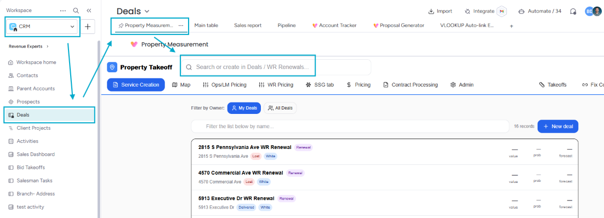

2. Once the property is selected, open the "Map" sub-tab and check that the service areas are highlighted accurately.

   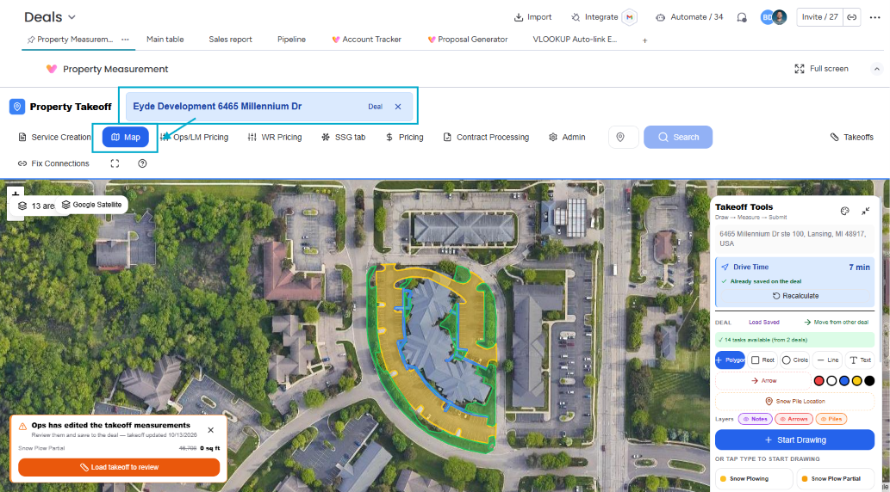

3. Use the layer visibility toggles in the tool pane at the top left of the map to show only the service you want to screenshot.

   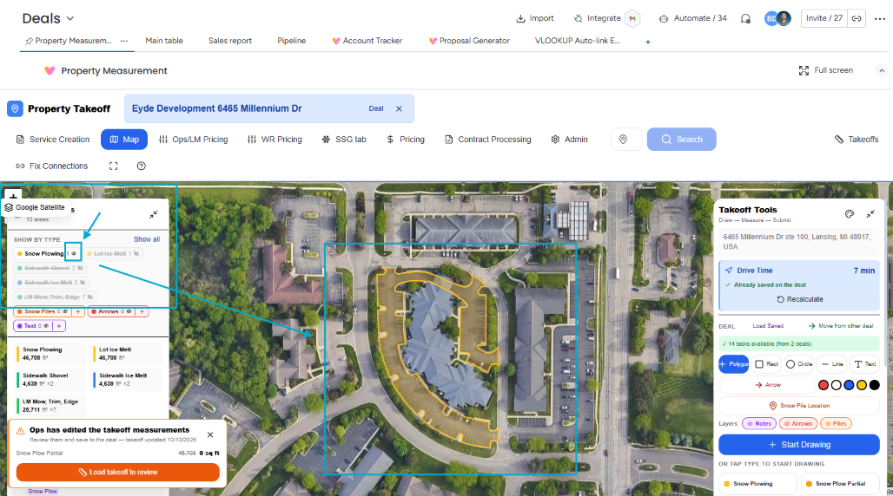

4. Take a screenshot of each service's map and save them to your computer.

## Copy the map template

5. Open the ["Map Making Spreadsheet"](https://docs.google.com/spreadsheets/d/1fKmMN_cNfEsFcgHaJILRFGpEXLEftVDoFv-5i8EFRxQ/edit?gid=0#gid=0) and the ["LookerStudio Maps Template"](https://datastudio.google.com/u/0/reporting/ba2b356d-3e4c-453e-bfc0-a0e74038bbbb/page/N3ZXD).

6. In the "LookerStudio Maps Template", click the three vertical dots at the top right to open its menu.

   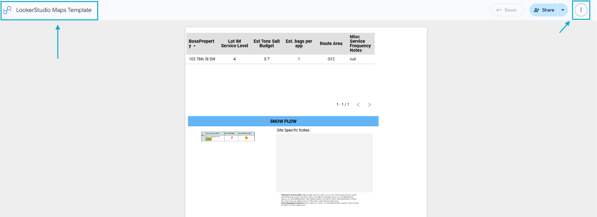

7. Select "Make a copy".

   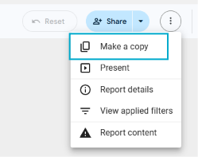

8. In the pop-up window, click "Copy report".

   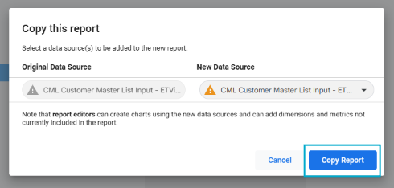

9. Rename the copy to the property's name in Monday.com followed by "Combined Maps" (for example, "Eyde Development 6465 Millennium Dr Combined Maps").

   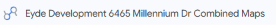

## Add the maps and notes

10. Click the "Image" icon in the toolbar and select "Upload from computer".

    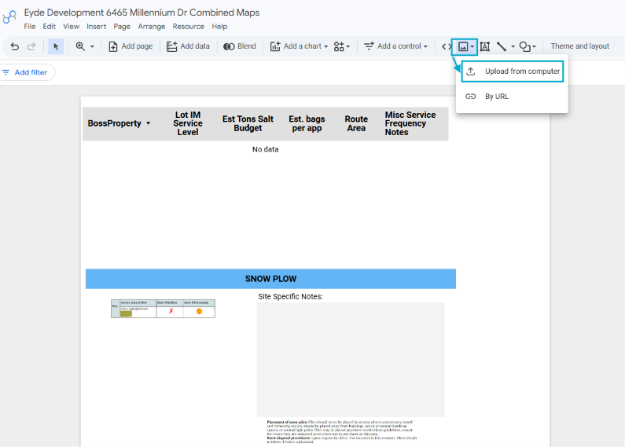

11. Resize the image and drag it into the matching section: "Snow Plow", "Lot Ice Melt", or "Sidewalk". Repeat steps 10–11 for each service map.

    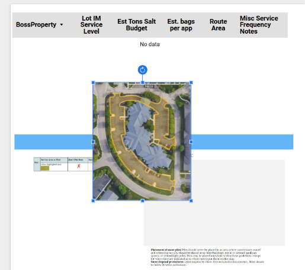

12. Add site-specific notes for each section in the light gray box to the right of its map.

    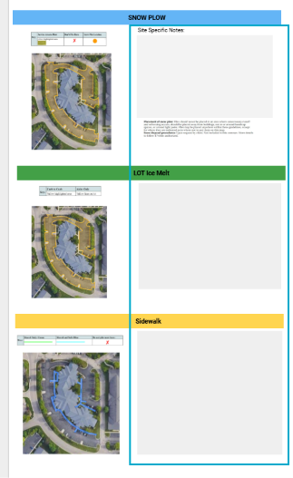

## Share the map

13. Click "Share" and add Gavin Reinink (gavin@snellersg.com) and Account Managers (acm@snellersg.com). Give them "Editor" permissions, uncheck the "Notify people" box, and click "Send".

    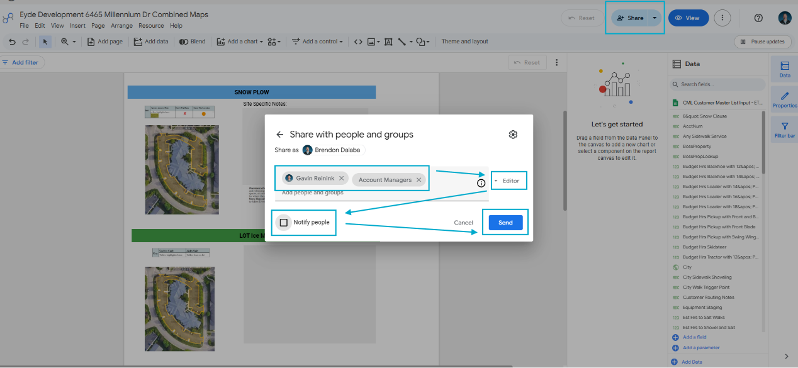

14. In the window that opens, go to "Link settings" at the bottom, change the type to "Unlisted", and check that the permission is set to "Viewer". Click "Copy link", then "Save".

    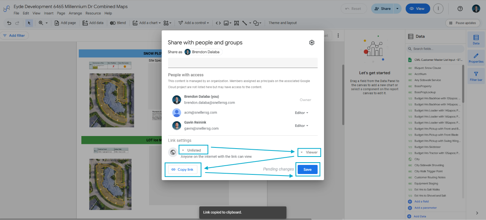

## Record the link

15. Paste the copied link into column E ("Looker Studio Link") on the property's row in the "Map Making Spreadsheet".

    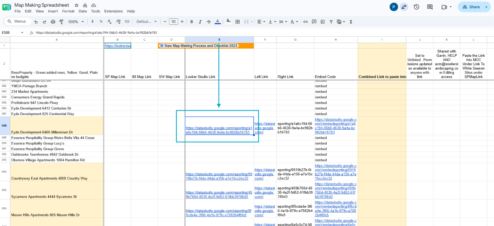

16. In CML on Monday.com, find and open the property, go to its "Item Card", and click the "link to White Season Sites" column.

    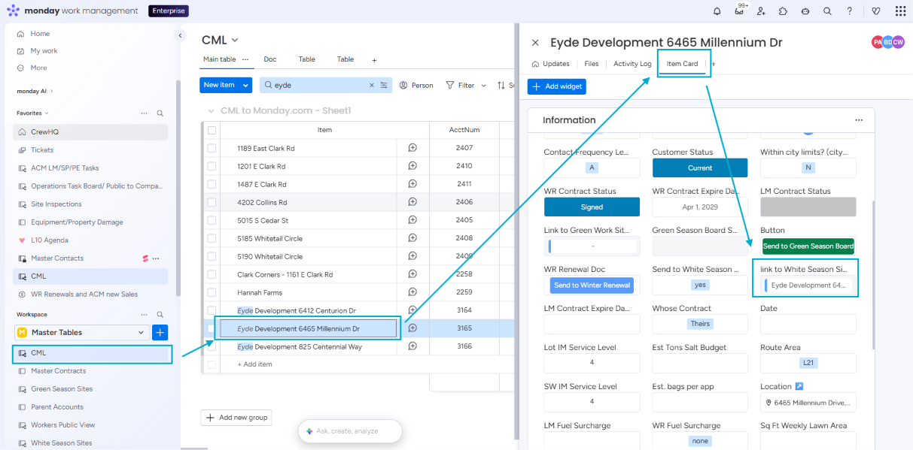

17. Scroll to the very bottom of the list that appears and paste the link into the "SPMapLink" box.

    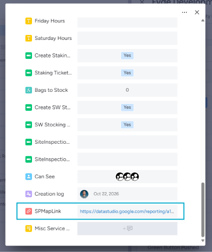
