## Create the deal

1. In Monday.com, open the CRM workspace and click "Deals".

   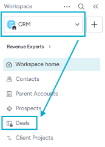

2. Open the "Main table" tab and click "New deal".

   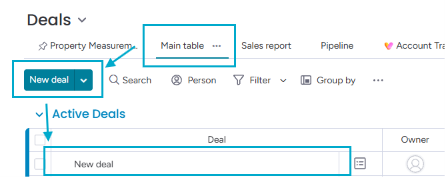

3. Fill in the details you already know in the deal's columns (for example, "Deal", "Owner", "Contacts", "Location", "Branch"). Scroll horizontally to reach all of the columns.

   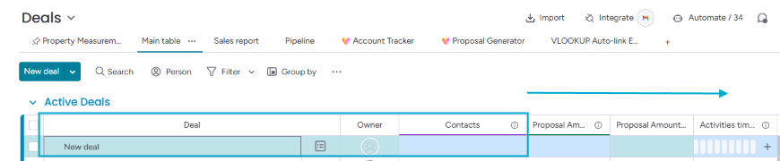

## Find the property

4. Open the "Property Measurement" tab, make sure the "Service Creation" sub-tab is selected, and search for your new deal.

   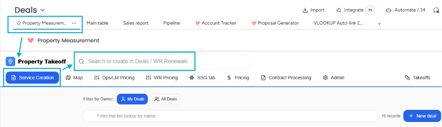

5. Select your deal from the dropdown list. It appears next to the "Property Takeoff" title. Then open the "Map" sub-tab.

   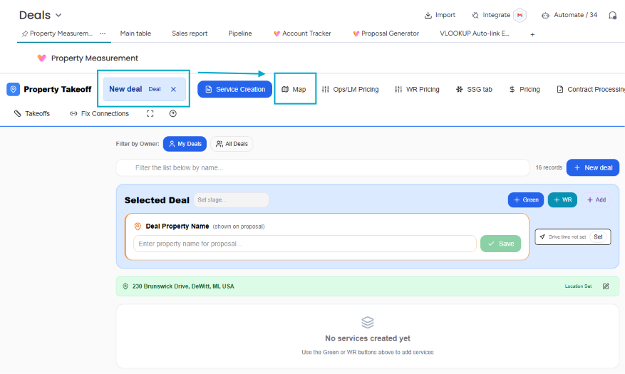

6. If you filled in the "Location" column, the map opens on the property. If not, type the address in the "Enter property address" box and click "Search".

   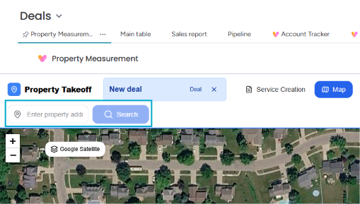

## Add WR services

7. Once the map shows the property, click "WR Services".

   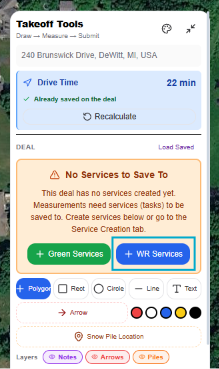

8. In the pop-up window, confirm the branch and services, then click "+ Create WR".

   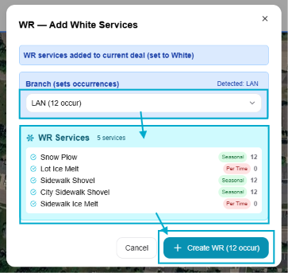

## Measure each service

9. Select the service you want to measure.

   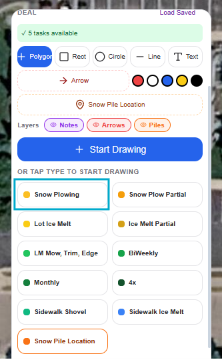

10. Draw the service area on the map, then click "Complete Area".

    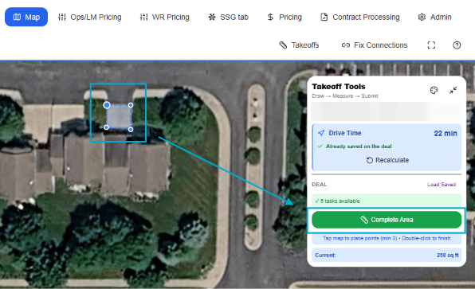

11. Click "Submit Measurements" at the very bottom of the tool panel on the right. **Measurements don't save automatically**, so submit them regularly as you work.

    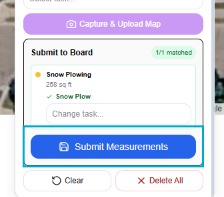

12. Repeat steps 9–11 for each service you plan to propose.

## Capture a map for each service

13. Use the measurement pane at the top left of the map to show only the service you're capturing, then click "Define Capture Area" in the tool panel on the right.

    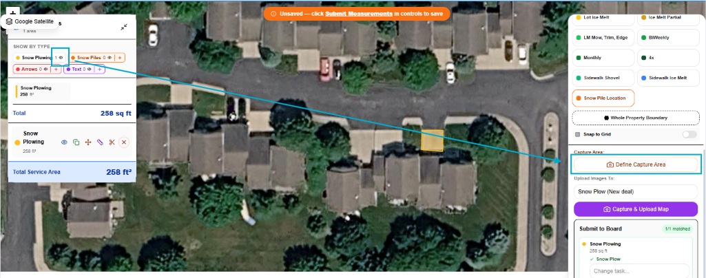

14. Select the service to assign the capture area to and click "Capture & Upload Map". The upload can take a while, so let it finish. Repeat steps 13–14 for every service.

    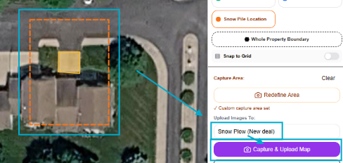

## Set the service types

15. Go back to the "Service Creation" tab and select the service type for each listed service.

    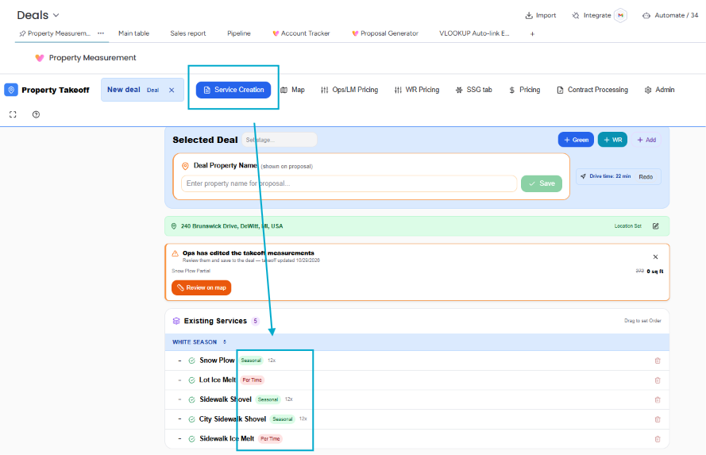

## Price the services

16. Open the "WR Pricing" tab and fill in "Lot Difficulty", "Size and Equipment", "Equipment Type", and "SP Production Rate". Unless told otherwise, copy the "SP Production Rate" from the automatically calculated production rate shown below the fields. Then enter the "Bid Amount" manually.

    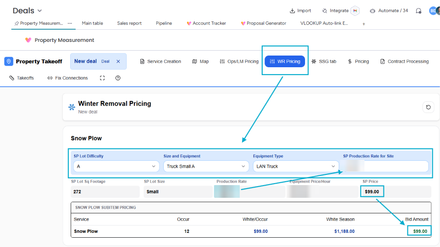

17. Scroll down and fill in the Sidewalk and Lot Ice Melt sections.

## Generate the proposal

18. Click "Proposal Generator" in the board's top navigation bar and select the property you've been working on.

    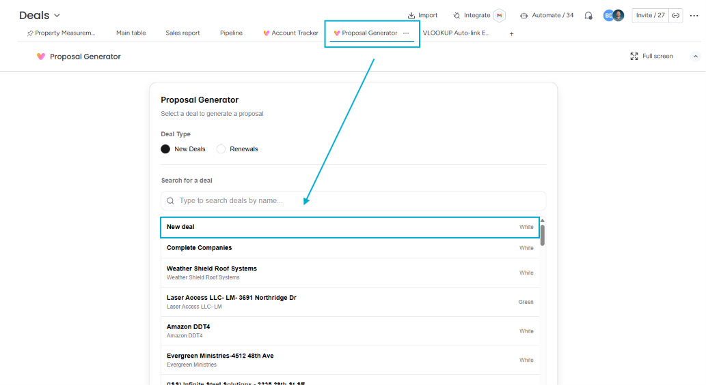

19. Fill in "Proposal Details", "Contract Duration", and "Terms Type". Review the "Terms & Conditions" and the property maps, then click "Download PDF".

    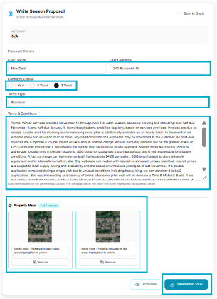
